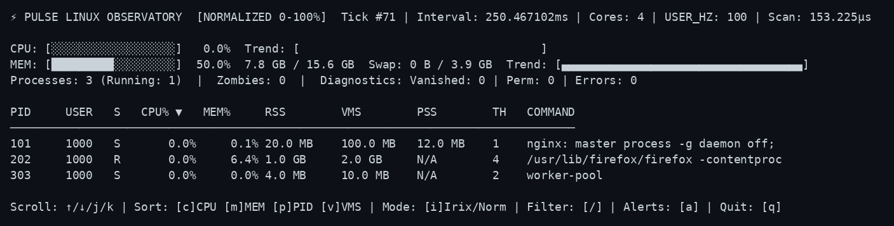

# Pulse Linux Observatory

Linux /proc telemetry with process identity tracking, two-sample CPU accounting, and a terminal dashboard.

[](https://github.com/khalid7344/pulse-linux-observatory/actions/workflows/ci.yml)
[](go.mod)
[](LICENSE)



Synthetic procfs fixture with PSS enabled; fixed counters yield zero CPU deltas.

## Overview and architecture

Pulse reads procfs through `io/fs.FS`; the same collectors accept fixture directories.
A `(PID, StartTime)` key prevents counters and history from crossing process lifetimes.

```text
/proc or fixture fs.FS
  -> procfs collector -> engine (deltas, identity, bounded history)
  -> alert evaluator -> terminal UI / headless reports / JSONL alerts
```

`cmd/pulse` handles flags and signals. `internal/model` defines samples and sinks;
`internal/procfs`, `internal/engine`, `internal/alert`, and `internal/tui` implement
the collection, accounting, alerting, and presentation layers. The telemetry engine
uses the standard library; the terminal interface uses Bubble Tea and Lip Gloss.

## Algorithmic core

Linux exposes cumulative CPU counters in clock ticks, not instantaneous CPU usage.
Pulse compares a baseline sample with the next sample. `delta(x)` means the current
counter minus its previous value, clamped to zero if the counter regresses.

### System CPU utilization

The first eight aggregate fields in `/proc/stat` give:

```text
total  = user + nice + system + idle + iowait + irq + softirq + steal
active = total - idle - iowait
system_cpu_percent = 100 * delta(active) / delta(total)
```

When `delta(total)` is zero, system CPU usage is zero. Results are clamped to
`0..100%`. `guest` and `guest_nice` are already included in `user` and `nice`;
adding them again would double-count guest time.

### Per-process utilization

A process's counter is `utime + stime` from `/proc/[pid]/stat`. Its two samples must
have the same `PID` and `starttime`; a new or recycled process starts at zero.

```text
process_ticks = utime + stime
normalized_percent = 100 * delta(process_ticks) / delta(total)
irix_percent = 100 * delta(process_ticks) / (elapsed_seconds * USER_HZ)
```

Normalized mode measures a share of the whole machine and is clamped to `0..100%`.
A zero total delta yields zero normalized usage. In Irix mode, `100%` means one
logical core; usage is clamped to `0..(100 * num_cores)%`. The CLI `--irix` flag and
TUI `i` key select the displayed mode. Process CPU alerts use normalized usage.

### Clock frequency

`USER_HZ` defaults to 100 ticks per second. Check your host with `getconf CLK_TCK`
and use `--user-hz` if needed. Keeping it configurable avoids a CGO dependency.
The denominator uses elapsed sampling time in seconds, not a duration in nanoseconds.

RSS is `rss_pages * page_size` from `/proc/[pid]/stat`. VMS is field 23 in bytes.
Optional PSS reads `Pss:` from `smaps_rollup` and converts KiB to bytes. PSS
apportions shared pages among mappings; unavailable PSS displays as N/A.

## Installation and quick start

### Linux amd64 release

Download [v1.0.0](https://github.com/khalid7344/pulse-linux-observatory/releases/tag/v1.0.0), verify the archive, then extract:

```sh
curl -fLO https://github.com/khalid7344/pulse-linux-observatory/releases/download/v1.0.0/pulse_v1.0.0_linux_amd64.tar.gz
curl -fLO https://github.com/khalid7344/pulse-linux-observatory/releases/download/v1.0.0/SHA256SUMS
sha256sum -c SHA256SUMS
tar -xzf pulse_v1.0.0_linux_amd64.tar.gz
./pulse --version
```

### Build from source

Requires Go 1.24+ and Git. Race tests also require a C compiler. The TUI requires
an interactive terminal; the report commands below work in scripts.

```sh
git clone https://github.com/khalid7344/pulse-linux-observatory.git
cd pulse-linux-observatory
CGO_ENABLED=0 go build -trimpath -buildvcs=false -o bin/pulse ./cmd/pulse
```

For repeatable binaries, use the same source commit, Go version, GOOS, and GOARCH.
Dependencies are pinned in `go.mod` and `go.sum`; verify them with `go mod verify`.

## Offline demonstration

From the cloned source directory after building:

```sh
./bin/pulse --proc-root=testdata/proc_fixtures/tick_01 --enable-pss
# Noninteractive report:
./bin/pulse --proc-root=testdata/proc_fixtures/tick_01 --once --enable-pss
```

## Usage

For live Linux telemetry:

```sh
./bin/pulse --enable-pss
./bin/pulse --once --json
./bin/pulse --headless --ticks=10 --interval=1s
```

Keys: `c` CPU sort, `m` RSS sort, `p` PID sort, `v` VMS sort, `i` Irix/normalized,
`/` filter, `a` alerts, `q` quit. Check `getconf CLK_TCK` and set `--user-hz` if
it differs from 100. Use `--help` for thresholds, history, and configuration flags.

## Testing and benchmarks

```sh
go vet ./...
go test -v -race ./...
go test -run '^$' -bench=. -benchmem ./...
```

Local sample: Linux amd64, AMD Ryzen 7 7700, Go 1.27.3,
`-benchtime=100ms`, captured during this update. Collector (300 synthetic processes): 715245 ns/op, 2354147 B/op,
6650 allocs/op. Engine tick: 55653 ns/op, 215990 B/op, 310 allocs/op.

Benchmark results depend on the host and Go toolchain. Run the command above
to measure the current checkout; microbenchmarks do not measure live end-to-end overhead.

## Scope and limitations

Fixtures validate parsing and accounting; an unchanged fixture produces zero CPU
deltas. Live collection is a sequential best-effort scan, not an atomic kernel
snapshot. PID reuse within one multi-file scan may mix auxiliary fields. Restricted
proc entries can be skipped; missing UID currently displays as 0. PSS is optional
and can be expensive. CPU percentages describe host counters, not cgroup quotas.
History is bounded per visible process; sink callbacks run synchronously. No
Prometheus exporter is implemented. Process arguments and logs may contain secrets.

## License

MIT. See [LICENSE](LICENSE). Third-party dependencies retain their own licenses.
